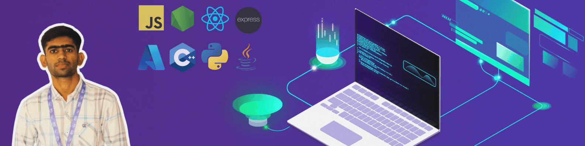

<div align="center">



# Hey, I'm Mubashir! 👋

**I build useful AI systems and experiment with language models for underrepresented languages.**

`AI Engineer` · `LLMs & NLP` · `Agentic Systems` · `ML Systems`

<a href="https://www.linkedin.com/in/mubashiralijamali/"></a>
<a href="https://huggingface.co/jamalimubashirali"></a>
<a href="https://doi.org/10.51846/vol9iss1pp6-18"></a>

</div>

---

### 👨‍💻 A little about me

- 🧠 **Data & AI Engineer @ Swich** — building AI-powered workflows and data systems.
- 🌍 Exploring **low-resource NLP**, especially language models for **Sindhi**.
- ⚙️ I enjoy the engineering behind AI: **RAG, agents, model training, and reliable systems**.
- 🔬 Curious about **tokenizers, efficient adaptation, and ML systems at scale**.
- ⚽ Away from the keyboard, you'll probably find me following football.

### 🧪 Currently on my workbench

**[SindhiLLM](https://huggingface.co/jamalimubashirali)** — my independent attempt to make a 1.1B-parameter language model more useful for Sindhi.

```text
Sindhi text
   └── tokenizer experiments & vocabulary extension
          └── continued pretraining / LoRA
                 └── instruction tuning & evaluation  (work in progress)
```

A big part of this project has been learning from what **didn't** work — including an early tokenizer extension that hurt continued pretraining — and testing better approaches.

🔗 [Explore the extended TinyLlama tokenizer](https://huggingface.co/jamalimubashirali/sindhi-tinyllama-tokenizer) · [Browse my Hugging Face](https://huggingface.co/jamalimubashirali)

### 🚀 Things I've built

| | |
| :--- | :--- |
| **[🔎 ARIA](https://github.com/jamalimubashirali/ARIA-Autonoumous-Research-and-Intelligent-Agent)**<br>Multi-agent research assistant with LangGraph, retrieval, streaming, and self-review. | **[🎓 EduAssist](https://github.com/jamalimubashirali/EduAssist)**<br>Personalized learning and gamification platform; the subject of our published research. |
| **[📝 NotesBuddy](https://github.com/jamalimubashirali/NotesBuddy)**<br>Turn learning content into notes and chat with it using RAG. | **[🔐 IAM-Agent](https://github.com/jamalimubashirali/IAM-Agent)**<br>Exploring identity, access control, and AI-assisted backend systems. |

### 🛠️ My toolbox

<div align="center">
  
</div>

<div align="center">

`Transformers` · `PEFT / LoRA` · `LangGraph` · `RAG` · `Hugging Face` · `SQL`

</div>

### 📄 A little research along the way

Co-authored **[EduAssist: Enhancing Academic Skills and Engagement Through Personalization and Gamification](https://doi.org/10.51846/vol9iss1pp6-18)**, published in the *Pakistan Journal of Engineering and Technology* (2026).

<details>
<summary>📊 GitHub stats</summary>
<br>
<div align="center">
  
</div>
</details>

---

<div align="center">

**Always exploring, building, breaking things, and learning from the results.** 🚀

Interested in collaborating on **LLMs, NLP, or ML systems**? [Let's connect](https://www.linkedin.com/in/mubashiralijamali/).

</div>
